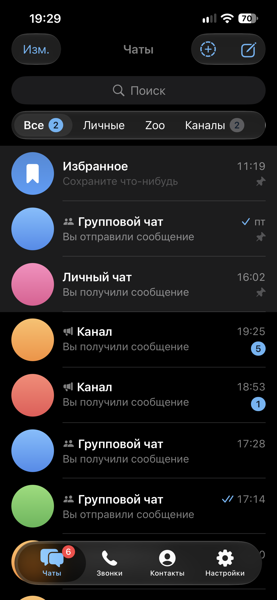

### 🛰 Кто я

Привет из Сибири ❄️ 
Занимаюсь проектами в свободное время. Пользуюсь топовыми код-агентами.
Проекты ещё в работе 🚧, так что что-то может ломаться. Если нашёл баг или есть идея, открывай issue, я читаю 💜

### 🪐 Что сейчас на орбите

<table>
<tr>
<td width="50%" valign="top">

**[Orbitle](https://github.com/fighxy/Orbitle)** 📱 

Приложение для MAX на SwiftUI с прозрачным дизайном Liquid Glass из iOS 26.
Голосовые, кружки, реакции и приватный режим.

</td>
<td width="50%" valign="top">

**[max-kmp-core](https://github.com/fighxy/max-kmp-core)** ⚙️ 

Сердце клиента: протокол, шифрование, сессия, чаты и медиа на Kotlin Multiplatform.
Всё, что под капотом.

</td>
</tr>
</table>

### 🧰 Чем пользуюсь

⭐ Поставь звезду Orbitle, и спутник полетит быстрее 🚀

